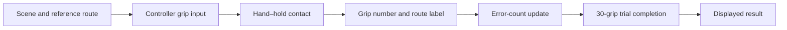
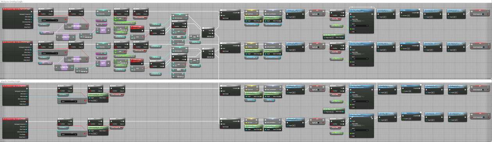
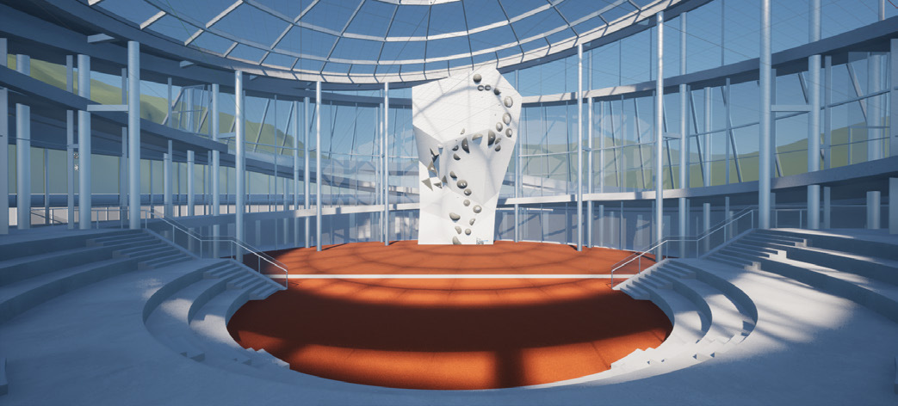
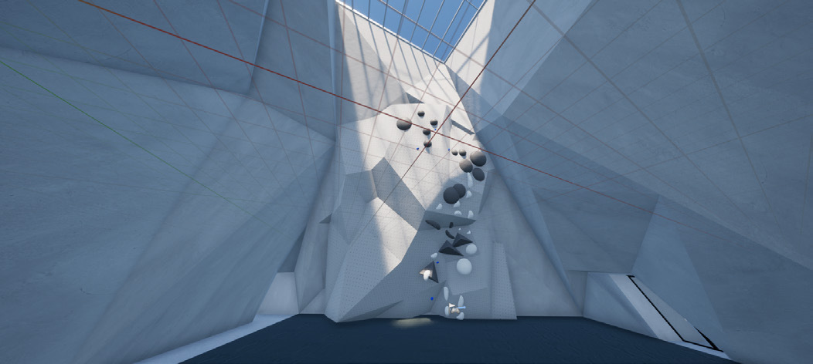

# VR climbing experiment: Unreal Engine and Blueprint logic

**Zihao Lin · Tsinghua University · Undergraduate thesis, 2025**

A VR climbing study connecting architectural enclosure, controller interaction
and route-following decisions. The workflow combines Rhino modelling, Unreal
Engine 5.4, Blueprint visual scripting and a Pico headset streamed from a PC.

This repository collects **original UE prototype assets** and the documented
experimental logic. The asset snapshot dates to 12–13 April 2025. The later
experiment is documented by the thesis and final presentation; its complete
executable project has not yet been recovered or tested here.

[Blueprint assets](unreal/Content/Project_0412) · [Implementation](docs/IMPLEMENTATION.md) · [Open in UE](docs/OPEN_IN_UNREAL.md) · [Experimental scenes](docs/SCENES.md)

## Interaction and programming

| Component | Retained implementation |
| --- | --- |
| VR character | `BP_VRCharacter`: VR Expansion character, movement and snap-turn nodes, grip/drop interface calls |
| Input setup | `BP_VRController`: Enhanced Input subsystem and mapping-context registration |
| Grippable objects | `BP_GripStaticMesh`: Blueprint based on `GrippableStaticMeshActor` |
| Controller actions | Left/right grab and thumb-axis assets, with an input-mapping context |
| Application setup | `BP_VRGamemode` and `VRtest_0412` test map |
| Experimental scoring | Thesis Blueprint figure and specification for route-index comparison, grip-error accumulation and trial completion |

The downloadable implementation consists of **Blueprint source assets** (`.uasset`
and `.umap`). The implementation notes map these assets to input handling,
character behaviour and the experiment workflow.

## Experimental workflow

The later study documented the following sequence:



The thesis describes a 20 cm hand-contact sphere, controller vibration on
successful contact, a route-index tolerance of three and a 30-grip trial limit.
The experimenter recorded the displayed result after each trial. These are
documented study behaviours, not a claim that the April prototype reproduces
the final scoring system. [Read the evidence and verification scope](docs/IMPLEMENTATION.md).

[](assets/grip-blueprint.png)

*Original thesis Figure 10. Open the image for the available full resolution.*

## Experimental environments

| Competition-space example | Training-space example |
| --- | --- |
|  |  |

Four environments were used: three competition-space conditions and one
training-space condition. The thesis labels the competition conditions 10%,
40% and 70% visible sky. [View all four scenes and the route display](docs/SCENES.md).

The spatial model became the *Twin Cliff* climbing-centre design in Zhangjiakou.
[See the final architectural outcome](docs/SCENES.md#architectural-outcome).

## Inspect the archive

```sh
python tools/inspect_assets.py
```

This standard-library utility checks the archived files against SHA-256 hashes
and reports selected package symbols and asset references. It was added during
repository preparation; it is not the original VR application or a runtime test.

To inspect the Blueprints visually, follow the [UE 5.4 setup instructions](docs/OPEN_IN_UNREAL.md).
The project-specific assets are supplied without engine binaries, starter packs
or third-party plugin source.

## Research record

**Thesis:** 建筑空间垂直围合度对攀岩决策表现的影响研究  
**Design:** 岩双阙 / *Twin Cliff*  
**Supervisor:** Zhang Li, School of Architecture, Tsinghua University

[Source record and scope](docs/SOURCE_RECORD.md) · [Dependencies and rights](THIRD_PARTY_NOTICES.md) · [GitHub profile](https://github.com/leolinnnn)
