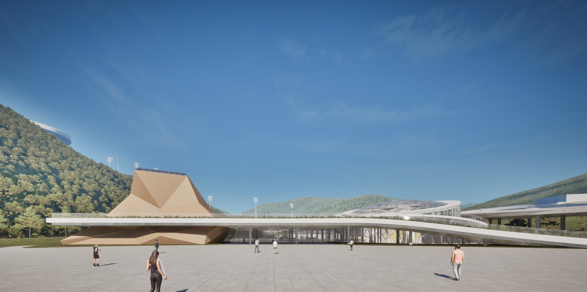
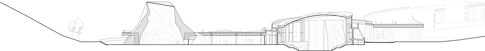
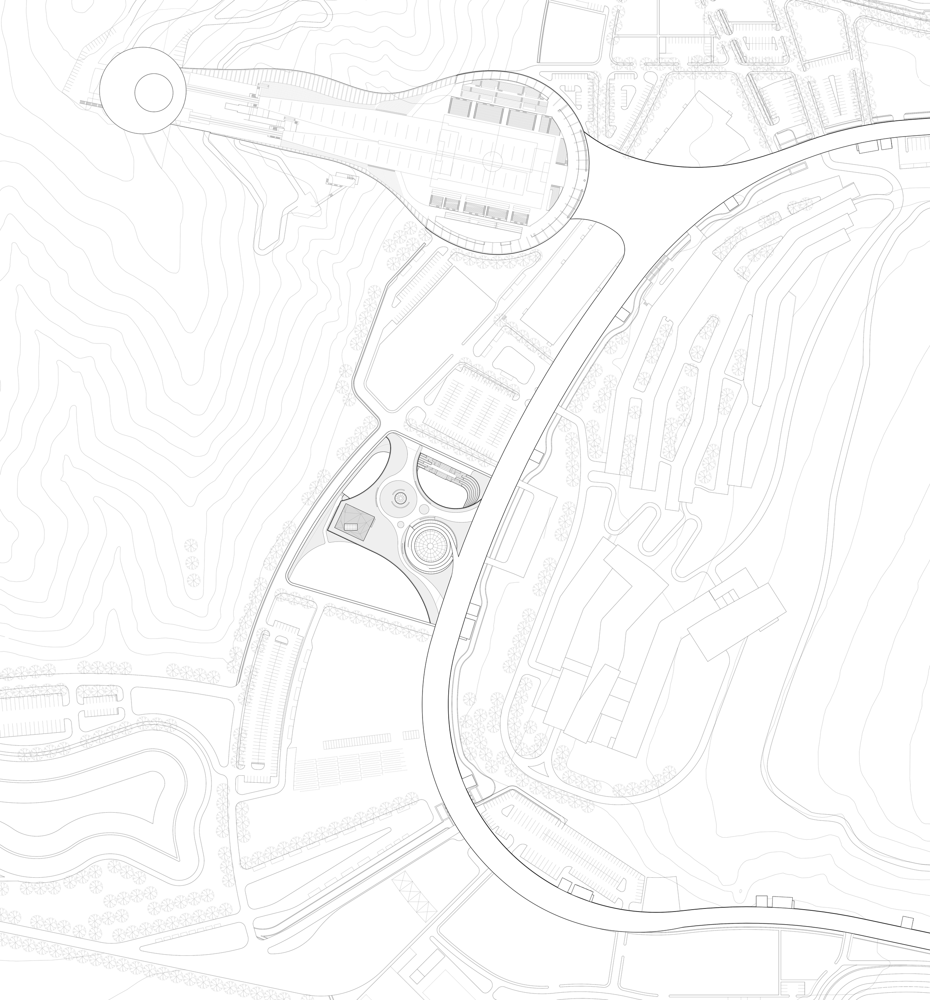
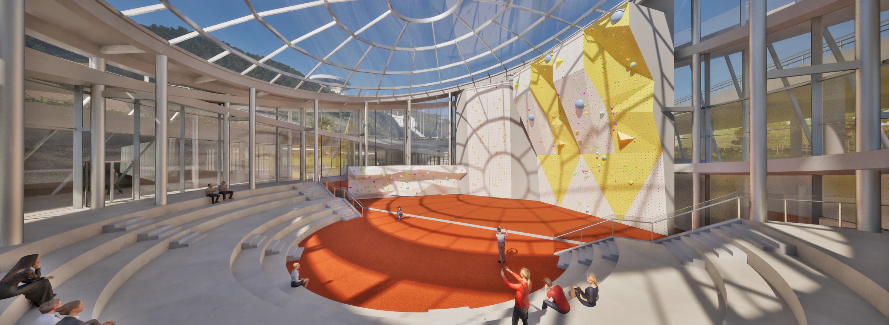
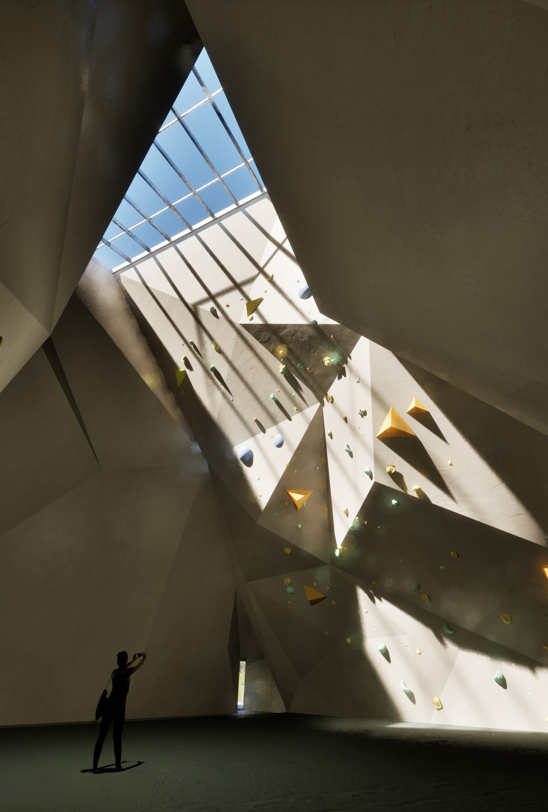

# Twin Cliff — final architectural design

[← Project overview](../README.md) · [UE implementation](IMPLEMENTATION.md)

**Zihao Lin · 岩双阙 / Twin Cliff · Final presentation, 25 May 2025**

Architectural figures from the final four-board drawing set. These renderings
and drawings describe the design outcome; the experimental environments are
documented in the separate [scene gallery](SCENES.md).

## Exterior and section

**Board 1 — exterior perspective.** The faceted training hall and glazed
competition hall share a continuous landscape platform.

**Board 1 — section A-A.** The section shows the different spatial enclosures
and their relationship to the sloping site. Open the image to inspect the drawing.

## Site and interior spaces

**Board 2 — site plan.** The climbing centre sits within the wider venue
landscape, connected by paths and the raised platform.

**Board 3 — competition hall.** A glazed enclosure brings the climbing arena,
circulation and spectator seating into one open space.

**Board 3 — training hall.** Tall walls and a roof opening create a contrasting,
more enclosed climbing space.

[Experimental scenes and reference-route display](SCENES.md) document the VR task.

## Image provenance

Source: the final `0525_layout` drawing set, corresponding to
`0525_layout_00.png` through `0525_layout_03.png`. Figures were extracted from
the matching PDF; web copies use proportional resizing and format conversion
without retouching or reconstruction. The original drawings and research
materials remain the source of record.
