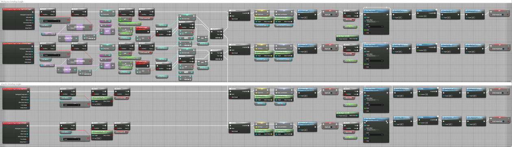

# Blueprint implementation and experimental logic

[← Overview](../README.md)

## Retained prototype assets

The archive preserves ten original files under `Content/Project_0412`: four
Blueprint classes, four input actions, one input-mapping context and one map.
Their combined size is 257,407 bytes. Their original modification dates are
12–13 April 2025.

| Asset | Evidence observed in the package | What it supports |
| --- | --- | --- |
| `BP_VRCharacter` | `VRCharacter`, `AddMovementInput`, `PerformMoveAction_SnapTurn`, `GripObjectByInterface`, `DropObjectByInterface` | Character locomotion and grip/drop integration |
| `BP_VRController` | `ReceiveBeginPlay`, `GetLocalPlayerSubSystemFromPlayerController`, `AddMappingContext`, `IMC_VRInputContext` | Input-context setup |
| `BP_GripStaticMesh` | `GrippableStaticMeshActor`, `VRGripInterface`, engine cube reference | Grippable-object configuration |
| `BP_VRGamemode` | Character and controller package references | Application class wiring |
| `IMC_VRInputContext` | Four input-action references; device-specific button/axis names | Controller mappings |
| `VRtest_0412` | Game-mode reference and built-in engine environment references | Test-map organisation |

These observations come from static package-string inspection. A symbol can
appear in metadata or an unconnected node. The inventory does not establish
graph execution order, active connections, input correctness or runtime success.

## Later experiment: documented scoring workflow

The thesis describes these steps:

1. Present a reference route before the participant starts a scene.
2. Detect hand–hold contact while the controller trigger is pressed. The hand
   contact model is described as a sphere with a diameter of 20 cm.
3. Register a successful grip and provide vibration feedback.
4. Compare the grip sequence number with the hold's reference-route label.
   The text describes a difference threshold greater than three; the Blueprint
   figure also shows absolute-value nodes in the comparison area.
5. Accumulate the grip-error measure and end the trial at 30 grip events.
6. Display the result for the experimenter to record.

The screenshot documents a later graph. Its corresponding editable asset has
not been matched to the retained prototype. Treatment of repeated contacts,
unlabelled holds and initial/reset state still needs to be checked in that final
graph. No substitute scoring algorithm has been added under the name of the
original implementation.

## Skills represented

- UE scene construction and the Rhino-to-engine workflow.
- Blueprint events, variables, branches and function/interface calls.
- VR controller input, character movement and object interaction.
- Integration of a behavioural task with a measurable trial outcome.
- Organisation of experimental conditions and participant instructions.

Blueprints are Unreal Engine's visual programming system. See Epic's
[Introduction to Blueprints](https://dev.epicgames.com/documentation/en-us/unreal-engine/introduction-to-blueprints-visual-scripting-in-unreal-engine).
