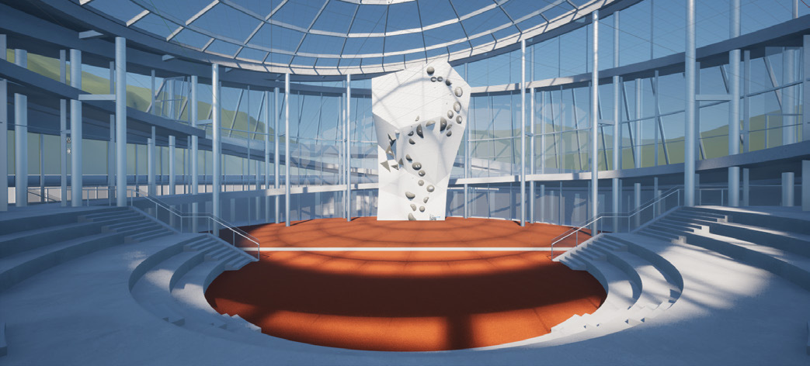
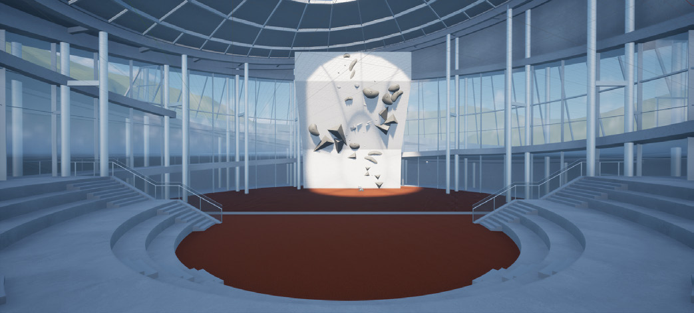
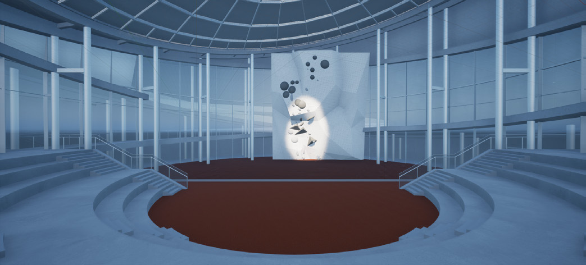
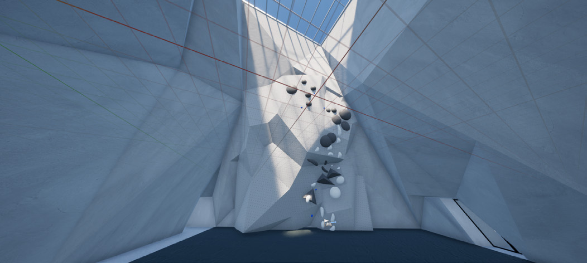
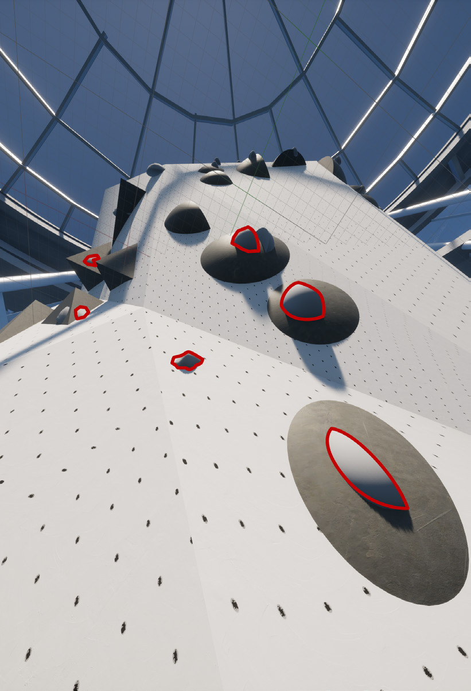
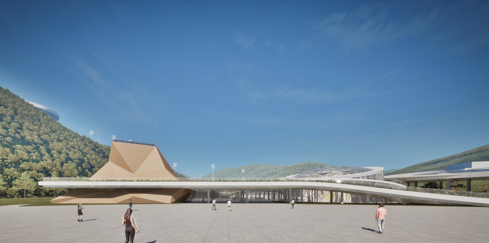

# Experimental scenes and architectural outcome

[← Overview](../README.md)

## Experimental scenes

| Competition scene A | Competition scene B |
| --- | --- |
|  |  |

| Competition scene C | Training scene |
| --- | --- |
|  |  |

These views follow the left-to-right order on board 4 of the final 25 May 2025
presentation. A, B and C identify the images; they do not independently assign
measured visible-sky values to the pictures.

## Reference-route display

The route display connects the spatial environment with the participant's task.
Source: final presentation board 4.

## Architectural outcome

*Twin Cliff*, Zhangjiakou. Final exterior perspective from board 1, dated
25 May 2025. The design combines a faceted training hall, a glazed competition
hall and a landscape platform.

## Figure provenance

The figures are the existing web copies extracted from the final `0525_layout`
PDF, corresponding to `0525_layout_00.png` through `0525_layout_03.png`. They were
proportionally resized or encoded for web display without retouching. This
repository copies those verified figures unchanged.
